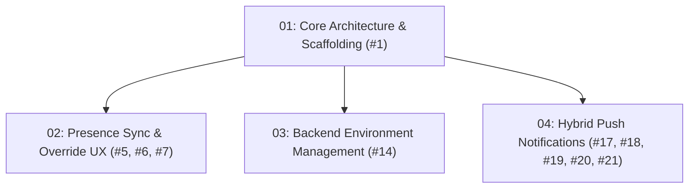

# simkuliah-presence-monitor Phase 1 (MVP) & Performance Roadmap

## 1. Executive Summary
This directory contains operational technical plans for **Phase 1 (MVP)** of simkuliah-presence-monitor.
All plans are contract-first, test-driven, and trace directly to open GitHub backlog issues.

---

## 2. Plan Catalog & Execution Sequence

| Plan | Document | Target Issues | Parent | Primary Stack | Status | Core Objective |
| :--- | :--- | :--- | :--- | :--- | :--- | :--- |
| **01** | [`01-architecture-mvp.md`](./01-architecture-mvp.md) | #1 | - | Core | Draft | Foundation architecture, scaffolding, and verification gates. |
| **02** | [`02-presence-sync-and-override-ux.md`](./02-presence-sync-and-override-ux.md) | #5, #6, #7 | 01 | Cross-stack | In Progress | Reconcile Simkuliah attendance and clarify manual override UX. |
| **03** | [`03-backend-env-management.md`](./03-backend-env-management.md) | #14 | 01 | Python | In Progress | Drive all backend configuration from a single `.env` file. |
| **04** | [`04-hybrid-push-notifications.md`](./04-hybrid-push-notifications.md) | #17, #18, #19, #20, #21 | 01 | Cross-stack | In Progress | Replace ntfy with FCM (Android) and in-app realtime (desktop). |

---

## 3. Definition of Done (DoD) for MVP & Release

Before declaring a phase complete and deploying to production:
1. **Contract Consistency**:
   - All REST API endpoints follow the unified envelope: `{ "code": 200, "message": "...", "data": ... }`.
   - Standardized machine-readable error codes for client-side branching (e.g. `ERR_NOT_FOUND`, `ERR_UNAUTHORIZED`).
2. **Automated Quality Verification**:
   - Pipeline passes completely: `python3 scripts/verify_pipeline.py`.
   - Zero linter warnings or errors.
   - Backlog parity verified: `python3 scripts/sync_backlog_status.py --check`.
3. **Resilience & Security**:
   - Secrets and environment keys isolated from version control.
   - Database migrations verified idempotent and reversible.

---

## 4. Planning Lifecycle & Archiving Governance

### Hybrid Planning Hierarchy
- **Epic & Architectural Roadmaps (`.planning/`)**: High-level technical specifications and cross-cutting plans (`NN-name.md`).
- **Feature Execution Logs (`docs/backlog/features/`)**: Task-level logs (`F-XXX-name.md`) tied to specific issues, linking to parent plans in `.planning/`.

### Plan Lifecycle Statuses
1. `Draft`: Architectural exploration or planning alignment in progress.
2. `Backlog`: Approved plan awaiting implementation priority.
3. `In Progress`: Active development under feature branches.
4. `Merged`: All child issues and pull requests merged into `main`/`dev`. Retained in root `.planning/` until release.
5. `Archived`: Moved to `.planning/archive/<version>/` upon milestone release.
